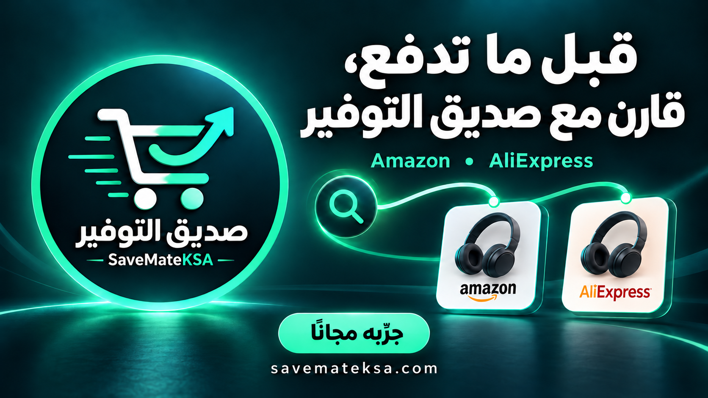

# صديق التوفير · SaveMateKSA

[English](README.md) · [افتح البوت](https://t.me/savemateksabot) · [الموقع](https://savemateksa.com)

بوت تيليجرام يساعدك في البحث عن المنتجات ومقارنة عروضها في Amazon وAliExpress. أرسل اسم المنتج بالعربية أو الإنجليزية، أو رابطه من أحد المتجرين، لتستعرض المعلومات والعروض التي يستطيع البوت جلبها. الردود بالعربية.

## طريقة الاستخدام

1. افتح [@savemateksabot](https://t.me/savemateksabot) واضغط **بدء**.
2. انضم إلى [قناة صديق التوفير](https://t.me/savemateksa) عند ظهور الطلب، ثم تحقق من عضويتك داخل البوت. الاشتراك بالقناة شرط لاستخدام الخدمة.
3. أرسل اسم منتج مثل «فأرة لاسلكية» أو `wireless mouse`، أو أرسل رابط منتج من Amazon أو AliExpress.
4. استعرض المعلومات والعروض، ثم افتح صفحة المتجر للتحقق من الخيار المطلوب وإجمالي الطلب.

استخدام البوت مجاني. بعض روابط الشراء تسويقية، وقد نحصل على عمولة من المشتريات المؤهلة.

## المزايا

- البحث في Amazon وAliExpress دون أفضلية لأحدهما.
- قبول أسماء المنتجات بالعربية والإنجليزية، مع محاولة ترجمة البحث العربي وإعادته عند غياب العروض المناسبة.
- عرض معلومات المنتج وروابط العروض وصور مصغرة عندما تكون متاحة.
- ترتيب النتائج بحسب صلتها بالمنتج، ثم سعر المنتج عند إمكانية المقارنة بالعملة والبيانات المتاحة.
- توضيح أن البدائل المشابهة ليست تطابقًا مؤكدًا مع المنتج المطلوب.
- البحث بالصورة بصفة تجريبية؛ قد تختلف دقته ومدة الاستجابة.

## قبل الشراء

لا يضمن البوت العثور على المنتج أو أقل سعر نهائي. قد تختلف العروض المشابهة في الموديل أو المقاس أو اللون أو الكمية أو الملحقات. تعتمد النتائج على البيانات التي تعيدها المتاجر.

قد لا يشمل السعر المعروض الشحن أو الضرائب أو الرسوم الأخرى. تحقّق من المواصفات والتوفر والتوصيل إلى عنوانك وإجمالي الطلب في المتجر قبل الدفع.

## الخصوصية والتواصل

استخدم `/privacy` داخل البوت لقراءة إشعار معالجة البيانات الحالي، و`/forget` لحذف بياناتك المحفوظة في البوت. للدعم تواصل مع [@savemateksa2](https://t.me/savemateksa2).

هذا المستودع للتعريف بالبوت وتوثيق استخدامه وعرض هويته البصرية. كود تشغيل الخدمة مغلق المصدر. Amazon وAliExpress متجران مستقلان؛ صديق التوفير ليس بوتًا رسميًا تابعًا لأي منهما. تبقى حقوق الهوية البصرية والعلامات التجارية لأصحابها.
